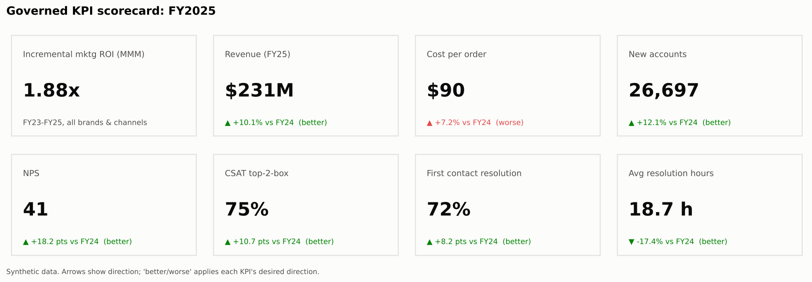
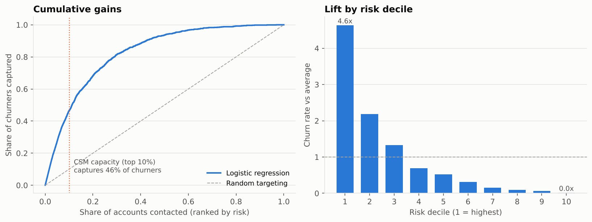
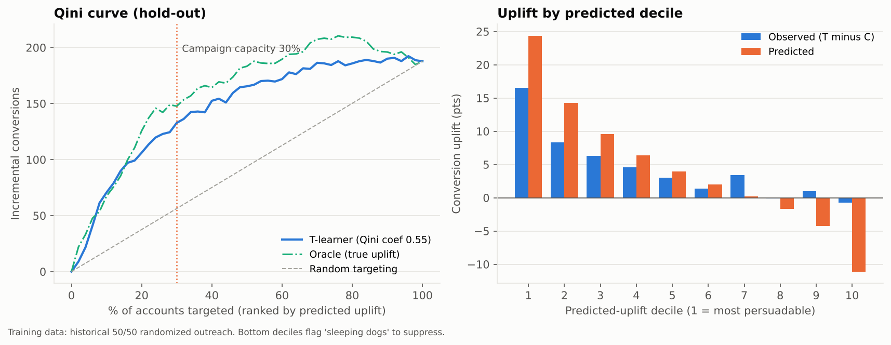
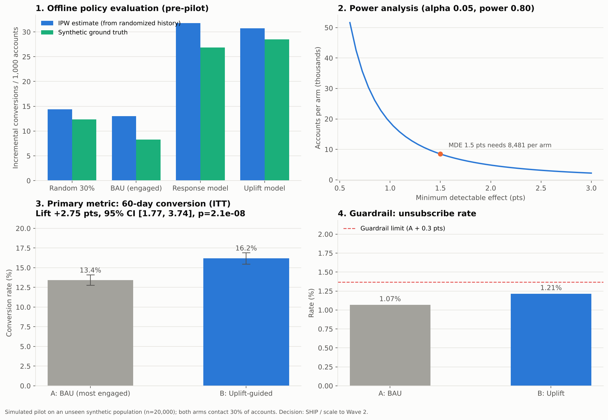
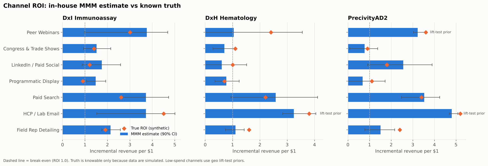
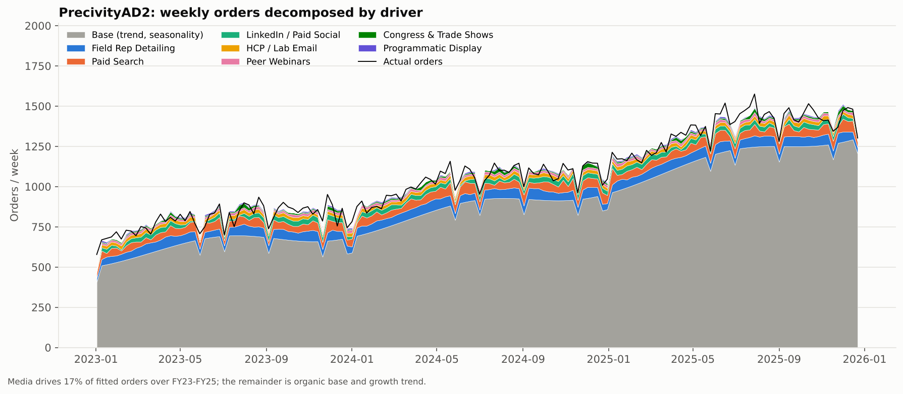
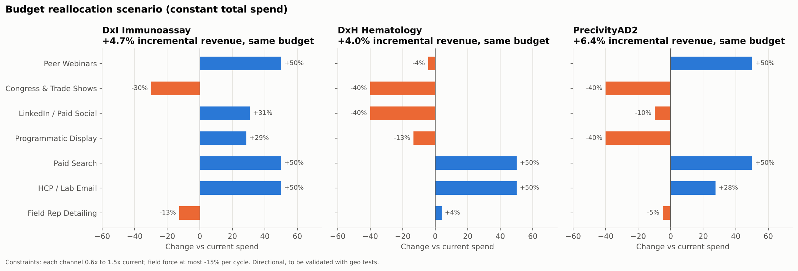

# CX Advanced Analytics & AI Technical Suite

End-to-end portfolio project for a biopharma / diagnostics **Customer Experience (CX) analytics and AI suite**: predictive algorithms, an in-house marketing mix solution, a governed KPI layer and the star-schema data model underneath them. Target customers are modeled on **BecDx** (clinical lab instruments and assays) and **N2C Dx**.

> **Disclaimer.** Every number in this repository comes from synthetic data generated by the code here. Company and product names are used only to make scenarios realistic; nothing reflects actual performance, customers or strategy of any company.



## What's inside

| Capability (suite pillar) | Product | Method | Headline result |
|---|---|---|---|
| Predictive Algorithms | Account attrition early-warning | Calibrated logistic regression vs gradient boosting, reason codes, subgroup checks | AUC 0.89, top-decile lift 4.6x |
| Predictive Algorithms | Next-Best-Action targeting | T-learner uplift model on randomized history | Qini 0.55; 2.4x true uplift vs random |
| Predictive Algorithms | MVP pilot | Pre-registered A/B test, power analysis, guardrails | +2.75 pts conversion (p = 2e-8), guardrail pass |
| Predictive Algorithms | Model monitoring | PSI drift on features and score | Retrain trigger fired on email fatigue |
| Performance Optimization | In-house marketing mix | Geo-pooled MMM, adstock + Hill, MAP with lift-test priors, optimizer | Hold-out MAPE 1.8 to 4.2%; +4 to 6% revenue at flat budget |
| Analytics & Insights | Governed KPIs + data model | Star schema, 12-KPI catalog, SQL views, DAX measures | 23 data-contract checks in CI |

One-pagers: [ML](docs/ML_OnePager.md) · [Analytics](docs/Analytics_OnePager.md) · Word versions plus the **CX in-house marketing mix strategy** brief are in [`docs/`](docs).

## Repository layout

```
cx-analytics-ai-suite/
├── configs/                  # pilot pre-registration (A/B design, guardrails, decision rule)
├── data/
│   ├── raw/                  # AI/ML dataset: cx_customer_ml_dataset.csv (24k accounts)
│   ├── warehouse/            # analytics star schema: 7 dim_* + 3 fact_* tables
│   └── processed/            # model outputs: churn worklist, KPI table, MMM ground truth
├── docs/                     # one-pagers (.md + .docx) and CX marketing mix strategy (.docx)
├── models/                   # serialized models (git-ignored; rebuilt by the pipeline)
├── notebooks/                # 01 data, 02 ML + pilot, 03 analytics + MMM (executed)
├── reports/
│   ├── figures/{ml,analytics}/   # all visualizations as PNG
│   └── metrics/              # JSON metrics consumed by docs and dashboards
├── scripts/                  # run_pipeline.py, build_notebooks.py
├── semantic_model/           # measures.dax, kpi_catalog.csv (business glossary)
├── sql/                      # Snowflake DDL, KPI views, MMM model-frame view
├── src/cx_suite/
│   ├── data/                 # synthetic generators with known ground truth
│   ├── ml/                   # features, churn, uplift, pilot design, monitoring
│   └── analytics/            # star schema + contracts, KPIs, MMM + optimizer
├── tests/                    # pytest: leakage guard, transforms, PSI, data contracts
├── .github/workflows/ci.yml  # lint, tests, full pipeline smoke run
├── Makefile · requirements.txt · LICENSE
```

## Quick start

```bash
git clone https://github.com/rickyemi/cx-analytics-ai-suite.git
cd cx-analytics-ai-suite
pip install -r requirements.txt
python scripts/run_pipeline.py      # ~40 s: data, models, MMM, KPIs, all PNGs and metrics
python -m pytest -q                 # unit tests and data contracts
make notebooks                      # re-execute the three notebooks
```

## Datasets

**AI/ML (`data/raw/cx_customer_ml_dataset.csv`)**: 24,000 accounts, 29 columns. Firmographics (company, customer type, tier, region), service signals (instrument downtime or result turnaround, tickets, resolution time), voice of customer (NPS with realistic non-response), digital and field engagement, commercial signals (order recency and trend, renewal timing, competitor presence, price change), a historical **randomized** outreach flag, outcomes (`churn_12m`, `converted_60d`, `unsubscribed_60d`) and ground-truth columns (`true_uplift`, `true_p_control`) used only for validation.

**Analytics warehouse (`data/warehouse/`)**: 156 weeks (2023 to 2025) x 3 brands x 5 regions x 7 channels (field reps, HCP/lab email, paid search, programmatic display, LinkedIn/social, congresses incl. ADLM, AAIC, AAN, CTAD, and peer webinars), plus 60,000 CX interactions. Orders are simulated from a known adstock + saturation process so MMM estimates can be checked against truth.

## Selected results

| | |
|---|---|
|  |  |
|  |  |
|  |  |

## Design principles

* **Outcomes, not outputs**: every model ships with offline gates, an online experiment and a business metric.
* **Ground truth by construction**: synthetic generators encode the true effects, so methods are validated, not just fitted.
* **Explainable and governed**: reason codes, subgroup parity checks, pre-registration, data contracts, one KPI definition reused in Python, SQL and DAX.
* **Compliant by design**: no PHI; models decide *who and when*, MLR-approved content decides *what*; consent, Sunshine Act and AdvaMed Code considerations documented in each one-pager.
* **Honest about limits**: low-spend channels are weakly identified in MMM, so geo lift-test priors and follow-up experiments are part of the method.

## Production path

Snowflake/Redshift + dbt for the data layer · MLflow registry and model cards · Airflow weekly batch scoring to Salesforce/Veeva CRM · Power BI on the governed semantic model · PSI drift alerts with champion/challenger retraining · Bayesian MMM (PyMC-Marketing or Meridian) once lift-test library matures.

## Author

YO · GitHub [@rickyemi](https://github.com/rickyemi). Released under the MIT License.
